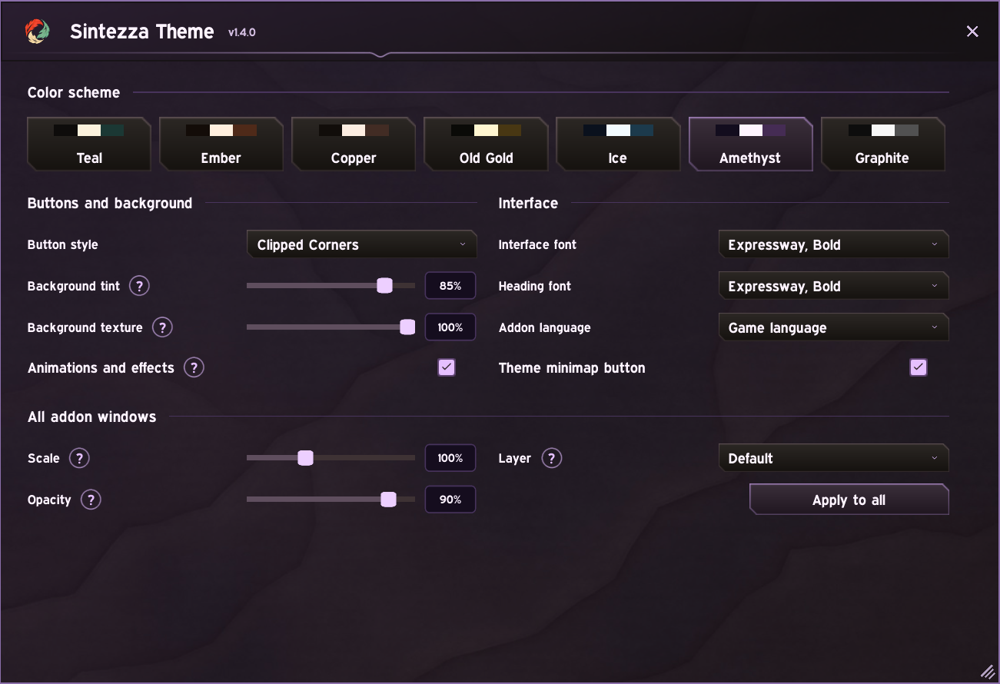
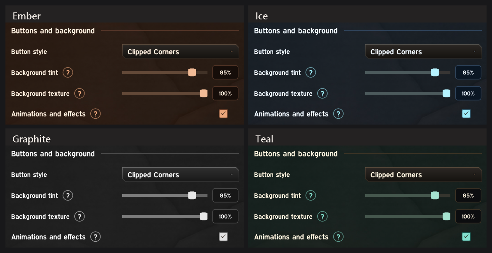
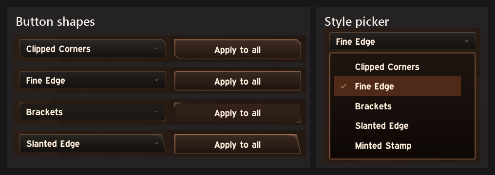

# Sintezza Theme

| CurseForge field | Value |
| --- | --- |
| Game | World of Warcraft |
| Class | Addons |
| Flavor and version | Forever 1.60.1 |
| Main category | Libraries |
| Additional categories | Artwork |
| CurseForge relations | None |
| Project license | MIT. See the repository for third-party notices. |

## Summary

Change UI themes, button styles, and fonts across Sintezza addons in WoW Forever.

## Description

Open `/stheme` or click the Theme minimap button to change the look of your Sintezza addons from one window.

### Color scheme

Pick from seven color schemes. The background and controls update in open Sintezza windows, including Vendor.

### Buttons and background

Choose a shared shape for buttons and tabs. Adjust background tint and stone texture separately, and toggle animations and effects.

### Interface

Choose separate fonts for interface text and headings. Set the addon language or let Theme follow the game's language. Reload the UI after changing languages.

### All addon windows

Apply scale, opacity, and layer to all connected windows. Theme lists the addons with different settings before asking you to confirm.

### Requirements

Sintezza Theme works on its own. Optional [SharedMedia providers](https://www.curseforge.com/wow/addons/sharedmedia) add fonts to the picker.

<!-- Changelog field -->

### Changelog

[View the release history on GitHub](https://github.com/ArtefactoO/Sintezza_Theme/blob/main/CHANGELOG.md).

Source, installation details, and credits are available on [GitHub](https://github.com/ArtefactoO/Sintezza_Theme).
