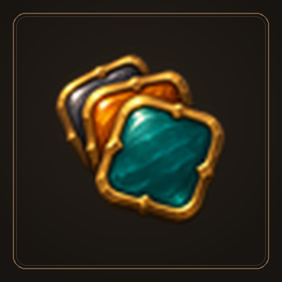
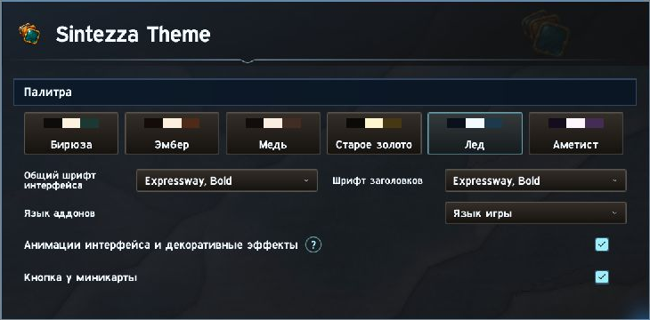

# Sintezza Theme



Sintezza Theme supplies the palettes, fonts, artwork, and controls used by Sintezza UI, Disenchant, Loot, Rivals, Vendor, and Execute. Change their shared appearance from one window.

## Installation and settings

Install `Sintezza_Theme` in `Interface/AddOns` alongside your other Sintezza addons. This release targets WoW Forever. Open the theme settings with `/stheme` or the minimap button. Drag the button to move it around the minimap, or turn it off in the settings.

- Pick Turquoise, Ember, Copper, Old Gold, Ice, or Amethyst. The palette tints the slate window background and controls.
- Pick the interface and heading fonts separately. The theme uses Spectral Medium for headings by default. Choose **Same as interface** to share a face.
- Choose English, Russian, or the game language. Other game languages use English. Run `/reload` after changing the language.
- Toggle decorative effects and interface animations. Appearance changes apply immediately outside combat and after combat ends if made during a fight.

The **Window and minimap** section in each addon controls scale from 50% to 200%, opacity from 20% to 100%, and the window layer. Position and size can be reset separately.

## Using the shared UI in an addon

Add `## Dependencies: Sintezza_Theme` to the addon's TOC and create themed widgets with the shared API.

```lua
local shared = Sintezza_Theme
local theme = shared:ForAddon()
local widgets = shared:CreateWidgets(theme)

local function AddOptions(parent, readScale, saveScale)
    local slider = widgets:SliderRow(parent, "Scale", 70, 130, 5, readScale, saveScale)
    slider:SetPoint("TOPLEFT", 12, -12)
    slider:SetPoint("TOPRIGHT", -12, -12)
end
```

Use `theme:WindowSurface(window)` and `theme:SidebarSurface(sidebar)` for the window surfaces, and `widgets:WindowHeader(window, options)` for the header. Pass `"BackdropTemplate"` when creating frames that need backdrops. Apply `shared:Tint(texture, "SetVertexColor", theme.accent)` to custom artwork that should follow the active palette.

Use `shared:GetFactionCrest(faction)` for Alliance and Horde emblems. Sintezza UI signals and Rivals faction columns share these textures. Pass the faction token of the character the icon represents.

`WindowOptions.lua` provides window and minimap options. Give `NewWindowPreferences` a callback for the addon's active profile, then bind the options to a standalone window with `Bind`. Pass a `resize` option to add the resize handle and persist window dimensions in the profile. `DataTransfer.lua` provides a shared CSV export, import, validation, and maintenance window. The addon defines the columns, available scopes, and handlers. Players copy or paste the CSV with Ctrl+C and Ctrl+V.

## По-русски

Тема объединяет оформление Sintezza UI, Disenchant, Loot, Rivals, Vendor и Execute. Установи папку `Sintezza_Theme` рядом с другими аддонами в `Interface/AddOns`. Этот выпуск предназначен для WoW Forever.

Открой `/stheme` или кнопку у миникарты. В окне доступны шесть палитр, отдельные шрифты интерфейса и заголовков, язык и декоративные эффекты. Чтобы шрифт заголовков совпадал с интерфейсом, выбери **Как в интерфейсе**. Для смены языка введи `/reload`. При изменении внешнего вида в бою тема применит настройки после выхода из боя.

Раздел **Окно и миникарта** у каждого аддона задает масштаб, непрозрачность и слой окна. Положение и размер сбрасываются по отдельности. Кнопку темы можно перетащить вокруг миникарты или скрыть в настройках.

## Credits and license

EllesmereUI and SinStats were visual references for Sintezza Theme. [EllesmereUI](https://www.curseforge.com/wow/addons/ellesmereui) · [SinStats](https://www.curseforge.com/wow/addons/sinstats)

Sintezza Theme is distributed under the MIT License. Fira Sans and Spectral are distributed under the SIL Open Font License 1.1. [MIT License](LICENSE) · [Fira Sans notice](Media/FiraSans-OFL.txt) · [Spectral notice](Media/Spectral-OFL.txt) · [Changelog](CHANGELOG.md)

## Gallery





[CurseForge listing fields](CURSEFORGE.md)
