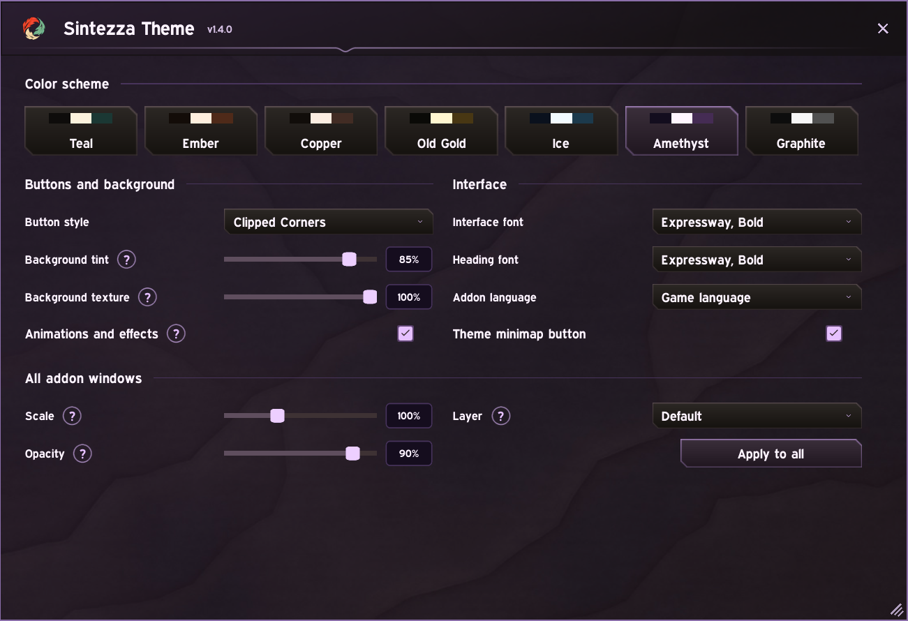
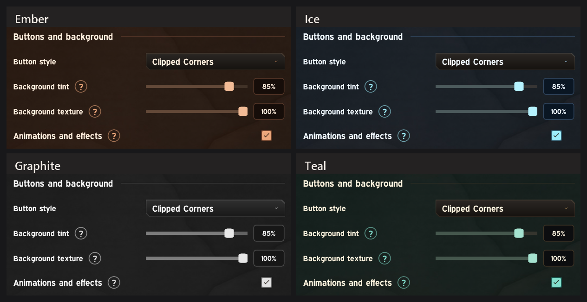

# Sintezza Theme


Sintezza Theme supplies the palettes, fonts, artwork, and controls used by Sintezza UI, Disenchant, Loot, Rivals, Vendor, and Execute. Change their shared appearance from one window.

## Installation and settings

Install `Sintezza_Theme` in `Interface/AddOns` alongside your other Sintezza addons. This release targets WoW Forever. Open the theme settings with `/stheme`, the minimap button, or **Open settings** on the Sintezza Theme page in WoW's AddOns menu. Left-click a Sintezza minimap button to open or close its window. Drag the Theme button to move it around the minimap, or turn it off in the settings.

The settings window opens automatically once per account after login, including existing profiles that have never recorded an opening. Opening it manually also completes this introduction. A login during combat defers the automatic opening until combat ends. The saved opening flag carries across UI reloads, character changes, and addon updates.

- Pick Teal, Ember, Copper, Old Gold, Ice, Amethyst, or Graphite.
- Pick a shared button style. Clipped Corners is the default, with Fine Edge, Brackets, Slanted Edge, and Minted Stamp also available.
- Adjust background tint and stone texture separately.
- Toggle decorative effects and interface animations. Appearance changes apply immediately outside combat and after combat ends if made during a fight.
- Pick the interface and heading fonts separately. The theme uses Spectral Medium for headings by default. Choose **Same as interface** to share a face.
- Choose English, Russian, or the game language. Other game languages use English. Run `/reload` after changing the language.

**All addon windows** applies the selected scale, opacity, and layer to connected windows. Theme asks before replacing different values in active addon profiles and lists the affected addons. Individual window options still let you set a local override.

## Using the shared UI in an addon

Add `## Dependencies: Sintezza_Theme` to the addon's TOC and create themed widgets with the shared API.

```lua
local shared = Sintezza_Theme
local theme = shared:ForAddon()
local widgets = shared:CreateWidgets(theme)

local function AddOptions(parent, readScale, saveScale)
    local slider = widgets:SliderRow(parent, "Scale", 70, 130, 5, readScale, saveScale)
    slider:SetPoint("TOPLEFT", 12, -12)
    slider:SetPoint("TOPRIGHT", -12, -12)
    widgets:Help(slider, "Changes the size of this window.")
end
```

Use `theme:WindowSurface(window)` and `theme:SidebarSurface(sidebar)` for the window surfaces, and `widgets:WindowHeader(window, options)` for the header. Pass `"BackdropTemplate"` when creating frames that need backdrops. Apply `shared:Tint(texture, "SetVertexColor", theme.accent)` to custom artwork that should follow the active palette.

Use `widgets:Help(row, text)` for a themed `?` tooltip. For an expandable row, place `theme:DisclosureArrow(row, size)` next to the label and call `arrow:SetExpanded(expanded)` when the row changes. Use `shared:RegisterLauncherPage(options)` for a Settings category that opens an addon's own window.

Optional consumers can create surfaces through `widgets:Surface(parent, name, role)`, with `window`, `sidebar` or `panel` roles. `widgets:DataTexture(parent, paletteKey, layer)`, `widgets:DataLine(parent, paletteKey, thickness)` and `widgets:ProgressBar(parent)` supply palette-aware marks; the consumer owns their geometry and measured values. Use `widgets:EditBox` and `widgets:ScrollFrame` for input/scroll controls. Anchor the returned scrollbar explicitly to the scroll area. `widgets:Tooltip(owner, title, body)` uses the shared tooltip beside its owner; pass `"cursor"` as a fourth argument to follow the cursor, with edge flipping and UI-scale handling. Call `shared:HideTooltip(owner)` on leave/hide. Cursor tracking runs only while that tooltip is visible; these helpers create no idle polling loop. Bind each standalone dialog to the addon's existing window preferences when scale, opacity and layer should follow its main window.

Use `shared:CreateMinimapButton(name, icon, settings, action, tooltip)` for a left-click toggle. Pass an existing toggle callback or a table with `window` and `open` callbacks and an optional `close` callback. Use `shared:BindMinimapToggle(button, action)` with an existing button.

Use `shared:GetFactionCrest(faction)` for Alliance and Horde emblems. Sintezza UI signals and Rivals faction columns share these textures. Pass the faction token of the character the icon represents.

`WindowOptions.lua` provides window and minimap options. Give `NewWindowPreferences` a callback for the addon's active profile, then register it with `shared:RegisterGlobalWindowPreferences(addonTitle, prefs)` and bind the options to a standalone window with `Bind`. Pass a `resize` option to add the resize handle and persist window dimensions in the profile. Create settings rows with `CreateWindowOptions`. Pass `heading = true` when the rows form a section within a larger page. For other groups of settings, use `widgets:Section(parent, title, nil, "settings")` for the same heading and rule. `DataTransfer.lua` provides a shared CSV export, import, validation, and maintenance window. The addon defines the columns, available scopes, and handlers. Players copy or paste the CSV with Ctrl+C and Ctrl+V.

`CreateWindowOptions` accepts optional `inset` and `labelRole` values for consumers that align its rows with neighboring settings. Shared slider rows synchronize from the accepted getter value after a setter returns; nested page refreshes do not re-enter setters.

## Credits and license

Inspired by [EllesmereUI](https://www.curseforge.com/wow/addons/ellesmereui) and [SinStats](https://www.curseforge.com/wow/addons/sinstats).

Sintezza Theme is distributed under the MIT License. Fira Sans and Spectral are distributed under the SIL Open Font License 1.1. [MIT License](LICENSE) · [Fira Sans notice](Media/FiraSans-OFL.txt) · [Spectral notice](Media/Spectral-OFL.txt) · [Changelog](CHANGELOG.md)

## Gallery



**Theme settings.** The Amethyst panel shows fonts, controls, and shared window settings.



**Four color schemes.** Compare background colors and accents in Ember, Ice, Graphite, and Teal.


**Button styles.** Compare four shapes and see all five in the style picker.

[CurseForge listing fields](CURSEFORGE.md)
