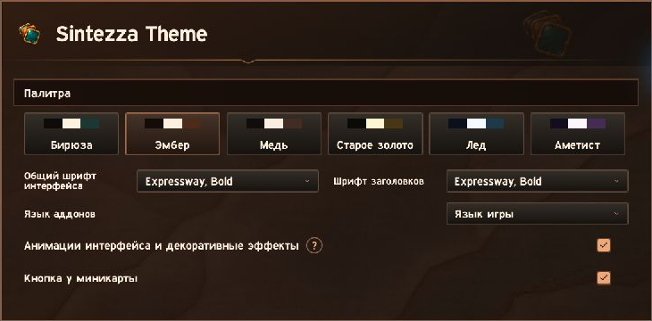
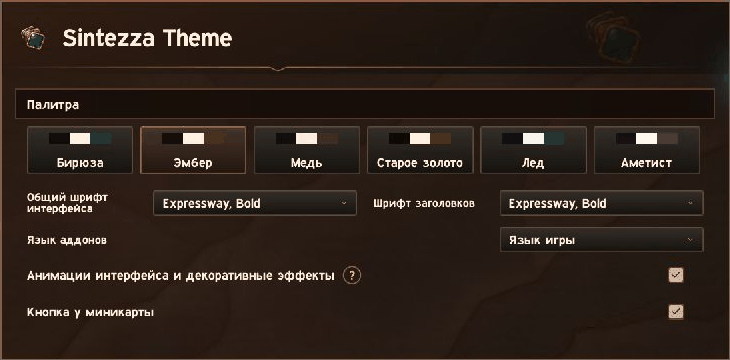

# Sintezza Theme


Sintezza Theme supplies the palettes, fonts, artwork, and controls used by Sintezza UI, Disenchant, Loot, Rivals, Vendor, and Execute. Change their shared appearance from one window.

## Installation and settings

Install `Sintezza_Theme` in `Interface/AddOns` alongside your other Sintezza addons. This release targets WoW Forever. Open the theme settings with `/stheme`, the minimap button, or **Open settings** on the Sintezza Theme page in WoW's AddOns menu. Left-click a Sintezza minimap button to open or close its window. Drag the Theme button to move it around the minimap, or turn it off in the settings.

- Pick Turquoise, Ember, Copper, Old Gold, Ice, Amethyst, or Graphite. Background tint and stone texture have separate controls.
- Pick a shared button style. Clipped Corners is the default, with Fine Edge, Brackets, Slanted Edge, and Minted Stamp also available.
- Pick the interface and heading fonts separately. The theme uses Spectral Medium for headings by default. Choose **Same as interface** to share a face.
- Choose English, Russian, or the game language. Other game languages use English. Run `/reload` after changing the language.
- Toggle decorative effects and interface animations. Appearance changes apply immediately outside combat and after combat ends if made during a fight.

**All addon windows** applies the selected scale, opacity, and layer to connected windows. Theme asks before replacing different values in active addon profiles and lists the affected addons. Individual window options still let you set a local override.

## Using the shared UI in an addon

Add `## Dependencies: Sintezza_Theme` to the addon's TOC and create themed widgets with the shared API.

```lua
local shared = Sintezza_Theme
local theme = shared:ForAddon()
local widgets = shared:CreateWidgets(theme)

local function AddOptions(parent, readScale, saveScale)
    local slider = widgets:SliderRow(parent, "Scale", 70, 130, 5, readScale, saveScale)
    slider:SetPoint("TOPLEFT", 12, -12)
    slider:SetPoint("TOPRIGHT", -12, -12)
    widgets:Help(slider, "Changes the size of this window.")
end
```

Use `theme:WindowSurface(window)` and `theme:SidebarSurface(sidebar)` for the window surfaces, and `widgets:WindowHeader(window, options)` for the header. Pass `"BackdropTemplate"` when creating frames that need backdrops. Apply `shared:Tint(texture, "SetVertexColor", theme.accent)` to custom artwork that should follow the active palette.

Use `widgets:Help(row, text)` for a themed `?` tooltip. For an expandable row, place `theme:DisclosureArrow(row, size)` next to the label and call `arrow:SetExpanded(expanded)` when the row changes. Use `shared:RegisterLauncherPage(options)` for a Settings category that opens an addon's own window.

Use `shared:CreateMinimapButton(name, icon, settings, action, tooltip)` for a left-click toggle. Pass an existing toggle callback or a table with `window` and `open` callbacks and an optional `close` callback. Use `shared:BindMinimapToggle(button, action)` with an existing button.

Use `shared:GetFactionCrest(faction)` for Alliance and Horde emblems. Sintezza UI signals and Rivals faction columns share these textures. Pass the faction token of the character the icon represents.

`WindowOptions.lua` provides window and minimap options. Give `NewWindowPreferences` a callback for the addon's active profile, then register it with `shared:RegisterGlobalWindowPreferences(addonTitle, prefs)` and bind the options to a standalone window with `Bind`. Pass a `resize` option to add the resize handle and persist window dimensions in the profile. Create settings rows with `CreateWindowOptions`. Pass `heading = true` when the rows form a section within a larger page. For other groups of settings, use `widgets:Section(parent, title, nil, "settings")` for the same heading and rule. `DataTransfer.lua` provides a shared CSV export, import, validation, and maintenance window. The addon defines the columns, available scopes, and handlers. Players copy or paste the CSV with Ctrl+C and Ctrl+V.

## По-русски

Тема объединяет оформление Sintezza UI, Disenchant, Loot, Rivals, Vendor и Execute. Установи папку `Sintezza_Theme` рядом с другими аддонами в `Interface/AddOns`. Этот выпуск предназначен для WoW Forever.

Открой `/stheme` или нажми ЛКМ на значок Theme у миникарты. Повторный ЛКМ закрывает окно. В окне доступны семь цветовых схем, включая серый «Графит». Тонировка и фактура фона настраиваются отдельно. Стиль кнопок можно переключать для всех подключенных аддонов. Шрифты интерфейса и заголовков, язык и декоративные эффекты тоже выбираются здесь. Чтобы шрифт заголовков совпадал с интерфейсом, выбери **Как в интерфейсе**. Для смены языка введи `/reload`. При изменении внешнего вида в бою тема применит настройки после выхода из боя.

Раздел **Окна всех аддонов** применяет масштаб, непрозрачность и слой разом. Если в активных профилях заданы другие значения, Theme перечислит затронутые аддоны и попросит подтверждение. Положение и размер окон по-прежнему настраиваются у каждого аддона.

## Credits and license

EllesmereUI and SinStats were visual references for Sintezza Theme. [EllesmereUI](https://www.curseforge.com/wow/addons/ellesmereui) · [SinStats](https://www.curseforge.com/wow/addons/sinstats)

Sintezza Theme is distributed under the MIT License. Fira Sans and Spectral are distributed under the SIL Open Font License 1.1. [MIT License](LICENSE) · [Fira Sans notice](Media/FiraSans-OFL.txt) · [Spectral notice](Media/Spectral-OFL.txt) · [Changelog](CHANGELOG.md)

## Gallery






[CurseForge listing fields](CURSEFORGE.md)
